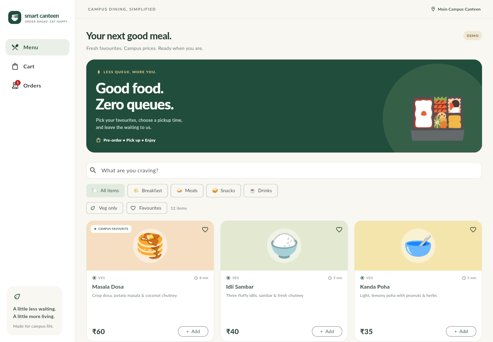
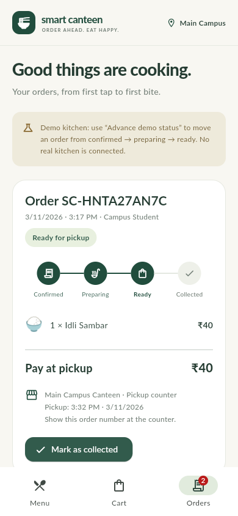

# Smart Canteen Pre-Ordering App

A Flutter student project for ordering campus meals ahead of time. Includes a digital menu, cart, checkout, and order tracking in a responsive Material 3 interface.





## Features

- Twelve Indian canteen dishes with rupee prices, preparation times, vegetarian labels, favourites, and sold-out states.
- Search dishes and filter by category, vegetarian items, and favourites.
- Add/remove items, adjust quantities (up to 20 per dish), and see exact totals.
- Checkout with a pickup name, a 15/30/45/60-minute pickup slot, and an optional kitchen note.
- Pay at the counter; this demo collects no payments.
- Track Confirmed → Preparing → Ready for pickup → Collected with labelled demo controls.
- Cancel before preparation; reorder completed/cancelled orders at current prices and availability.
- Save the cart, favourites, and order history locally using `shared_preferences`.
- Duplicate-submit protection and save-before-commit checkout; a failed save keeps the cart available.
- Phone bottom navigation and a desktop sidebar, with bundled fonts and emoji artwork.

## Run

Validated with Flutter **3.47.9** / Dart **3.13.7**. Use this stable version or a compatible newer Flutter SDK. Android, iOS, and web scaffolds are included.

```sh
flutter pub get
flutter run -d chrome
```

Alternatively, serve to any browser:

```sh
flutter run -d web-server --web-port 8080
```

Open `http://localhost:8080`. For Android, start an emulator or connect a device and run `flutter run`. An Android SDK and JDK are required. iOS builds require macOS and Xcode.

## Demo walkthrough

1. Search for Masala Dosa and tap **Add**.
2. Open **Cart**, adjust a quantity, and enter a pickup name.
3. Choose a pickup slot, optionally add a note, and tap **Place demo order**.
4. In **Orders**, tap **Advance demo status** twice to demonstrate preparation and readiness.
5. Tap **Mark as collected**, then **Order again** to repeat the order.
6. Reload to confirm that local cart, favourites, and orders are retained.

## Validation

```sh
flutter analyze
flutter test
flutter build web --release --no-web-resources-cdn
```

There are 13 automated tests covering totals, quantity limits, sold-out items, checkout validation, save failures, duplicate submission, persistence, order transitions, cancellation/reordering, the full phone checkout flow, and 360/768/1440-pixel layouts. Android and iOS binaries have not been built or tested in this workspace.

Build an Android APK on a machine with the Android toolchain:

```sh
flutter build apk --debug
```

The generated release configuration uses Flutter's development signing setup. Configure your own application ID and release signing before store distribution.

## Code map

| File | Responsibility |
| --- | --- |
| `lib/main.dart` | Startup, theme, navigation, responsive shell |
| `lib/models.dart` | Sample menu, order models and immutable order snapshots |
| `lib/store.dart` | Local storage, cart operations, checkout and status rules |
| `lib/screens.dart` | Menu, cart form and order tracking |
| `lib/components.dart` | Reusable cards, artwork, prices and quantity controls |
| `test/controller_test.dart` | Cart, persistence and state tests |
| `test/app_test.dart` | Full user flow and layout checks |

## Scope

This is a functional **single-device project demo**. Orders and kitchen notes stay on the device/browser profile; kitchen status changes use manual demo controls. Pickup slots are relative to the device's current time. No login, online payments, server, live stock reservation, push notifications, or actual kitchen delivery is included. Clearing app/browser data removes local records. Preferences are suitable for this demonstration, not a production order database.

For a real canteen, add an authenticated backend, server-side pricing/stock validation, a kitchen dashboard, live status updates, opening hours and pickup capacity, reliable order storage, and an optional payment provider.

## Resources and licences

- [Flutter installation](https://docs.flutter.dev/install)
- [Flutter web setup](https://docs.flutter.dev/platform-integration/web/setup)
- [shared_preferences](https://pub.dev/packages/shared_preferences)
- [Lato font source](https://github.com/google/fonts/tree/main/ofl/lato); SIL Open Font License in `assets/fonts/OFL.txt`.
- [Noto Color Emoji source](https://github.com/googlefonts/noto-emoji); SIL Open Font License in `assets/fonts/NotoEmoji-LICENSE.txt`.

Sample food artwork uses Unicode emoji rendered with the bundled Noto font. No image API keys are required.
